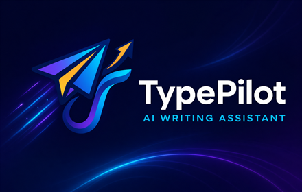

  
  <h1>TypePilot - AI Writing Assistant</h1>
  
  
  
    
  <a href="https://kyriakosgian.github.io/TypePilot/">Website</a> ·
  <a href="https://github.com/KyriakosGian/TypePilot/releases/download/v1.4.0/TypePilot-v1.4.0.zip">Download v1.4.0</a> ·
  <a href="https://github.com/KyriakosGian/TypePilot/releases">Releases</a>

TypePilot is a Chrome extension that helps you write and correct text instantly with Google Gemini Free. Select text in any editable field, then fix spelling and grammar in one click or rewrite, translate, shorten, and adjust the tone.

TypePilot uses your own Google Gemini API key and communicates directly from the browser to Google. There is no TypePilot backend or intermediate proxy.

Google determines Gemini free-tier availability, quotas, and any charges for the model and API project you choose. See [Gemini API pricing](https://ai.google.dev/gemini-api/docs/pricing).

## What's New in 1.4.0

- Create polished standard X posts that fit the 280-character limit, preserve links and mentions, and use up to two relevant hashtags.
- The bundled official twitter-text parser validates the complete post, including unselected text, Unicode, emoji, and bare-domain links. Invalid generations receive one corrective attempt, never a blind URL-cutting fallback.
- The original editor text is saved temporarily before replacement, with the latest five backups available in Settings under Recovery.
- Selection detection now works with pointer and keyboard selection in more contenteditable editors and matching iframe fields.
- Immutable snapshots block replacement if the original editor changed while Gemini was working. The entire resulting editor is checked after insertion.
- Use Copy result for manual pasting, or Ctrl+Shift+Y (Command+Shift+Y on Mac) to invoke Fix from the keyboard.

## Writing Actions

| Action | Result |
|---|---|
| Fix | Corrects spelling, grammar, punctuation, and syntax while preserving meaning and language. |
| Rewrite | Improves clarity, flow, and natural phrasing. |
| Translate to selected language | Produces a natural translation in the configured target language while preserving facts and formatting. |
| Shorten | Makes the text more concise without removing essential information. |
| Post for X | Creates a polished post within the standard 280-character limit, preserving links and mentions. |
| Formal tone | Rewrites the text in a clear, professional tone. |
| Friendly tone | Rewrites the text in a warm, natural tone. |

## Features

- One-click correction with six additional actions in the dropdown.
- Post for X with weighted character validation, URL-aware length handling, and up to two relevant hashtags.
- Configurable translation target with 25 supported languages and English as the default.
- Structured JSON responses enforced through the Gemini API schema.
- Compatible Gemini model picker, including Gemini 3.1 Flash-Lite and Gemini 3.5 Flash when available.
- Custom writing instructions shared by all actions.
- Personal Dictionary with one protected term per line.
- Result caching, cancellation, and automatic transient-error retry.
- Model, token usage, response time, and cache details in the information panel.
- Support for standard inputs, textareas, more contenteditable editors, Shadow DOM fields, keyboard selection, and matching iframe fields.
- Temporary Recovery backups for the five most recent replacements in the current browser session.
- Clipboard changes happen only when you explicitly choose Copy result or Copy Original.
- Local settings storage and direct browser-to-Google requests.

## Installation

1. Download the latest [TypePilot release](https://github.com/KyriakosGian/TypePilot/releases/latest).
2. Extract the downloaded ZIP file.
3. Open `chrome://extensions/` in Chrome.
4. Enable Developer mode.
5. Select Load unpacked.
6. Choose the extracted TypePilot folder.
7. Pin TypePilot to the Chrome toolbar.

## Configuration

1. Open TypePilot Settings from the toolbar icon.
2. Create a Gemini API key in [Google AI Studio](https://aistudio.google.com/app/apikey).
3. Enter the key in TypePilot.
4. Choose an available Gemini text model.
5. Choose the target language used by the Translate action.
6. Optionally customize the writing instructions and Personal Dictionary.
7. Save the settings.
8. Reload any website tabs that were open before the extension was installed or updated.

Gemini 2.5 Flash-Lite remains the compatibility fallback. Gemini 3.1 Flash-Lite is optimized for speed, while Gemini 3.5 Flash is intended for higher-quality output when those models are available to the API key.

## Usage

1. Select text inside a supported editable field.
2. Click Fix for immediate correction.
3. Open the arrow on the right to choose Rewrite, Translate to your configured language, Shorten, Post for X, Formal tone, or Friendly tone.
4. Click the returned result to replace the selected text.
5. Open the information icon to view the model, token usage, response time, and cache status.

You can invoke Fix with Ctrl+Shift+Y on Windows/Linux or Command+Shift+Y on Mac. Customize a conflicting shortcut at `chrome://extensions/shortcuts`.

If the editor changed or rejects an insertion, keep the new draft and use **Copy result** to paste manually. In Settings, open **Recovery**, select any of the five backups, and choose **Copy Original**. Editors over 100,000 characters use manual copying because a complete Recovery backup cannot be guaranteed within the supported limit.

Chrome system pages, the Chrome Web Store, closed Shadow DOM editors, and editors that do not expose browser text selections are not supported. Matching iframe fields are supported when Chrome permits script injection. Compatibility with a site's live editor can change independently of this extension.

## Development and Tests

The extension remains plain JavaScript and CSS with no runtime build or dependency installation.

- Run `node --test tests/regression.test.cjs` for storage, validation, timeout, cancellation, and shortcut regression tests.
- Run `node tests/browser.cjs` with Playwright and its Chromium available for real unpacked-extension editor tests. `TYPEPILOT_PLAYWRIGHT` can point to an existing Playwright package and `PLAYWRIGHT_BROWSERS_PATH` to its browser cache.
- Set `TYPEPILOT_CAPTURE=1` when running the browser suite to regenerate the five neutral store screenshots after the checks pass.
- GitHub Actions runs both the regression suite and Chromium editor checks on pushes and pull requests.
- Run `powershell -File scripts/package.ps1` on Windows (or `pwsh -File scripts/package.ps1`) to regenerate the extension-only ZIP and checksums.

Browser tests use a temporary profile and mocked Gemini responses. They do not use personal browser data or make live Gemini requests. They test representative editors, not signed-in X, Gmail, or WordPress accounts.

## Privacy

The API key, selected model, translation language, writing instructions, and Personal Dictionary are stored in `chrome.storage.local`. Recovery keeps up to five original editor backups in `chrome.storage.session` until the browser session ends. Access is restricted to trusted extension contexts when supported by Chromium.

The selected text and relevant writing settings are sent directly to Google only when TypePilot makes a Gemini API request. No TypePilot backend or third-party proxy receives them.

Read the full [TypePilot Privacy Policy](PRIVACY.md).

## Credits

- Created by [KyriakosGian](https://github.com/KyriakosGian)
- Website: [kyriakosgian.github.io/TypePilot](https://kyriakosgian.github.io/TypePilot/)
- Supported by [ProCreta.gr](https://procreta.gr)

See [CHANGELOG.md](CHANGELOG.md) for the version history.
